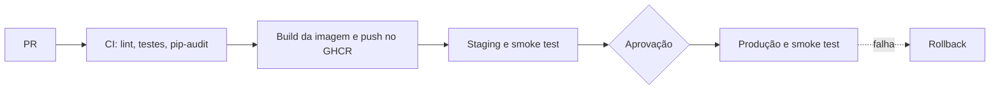

# Café com Deploy

API de cafés especiais com pipeline de CI/CD (GitHub Actions, Docker, GHCR e Render).

- Staging: (colocar link)
- Produção: (colocar link)

Para rodar local: `cp .env.example .env` e `docker compose up --build`. A documentação da API fica em http://localhost:8000/docs.

## Relatório de Voo

### 1. Pipeline

### 2. Diagnóstico

Antipadrões da Café com Deploy e o que usamos no lugar:

| Antes | Agora |
|---|---|
| Deploy por FTP | Pipeline disparado pelo merge na main (cd.yml) |
| Testar só no final | Staging com a mesma imagem da produção |
| Configuração manual | Variáveis de ambiente e GitHub Environments |
| Funciona na minha máquina | Docker |
| ALTER TABLE manual | Migrations com Alembic |
| Senha no código | Secrets do GitHub e .env fora do Git |
| Dependências soltas | Versões fixas, Dependabot e pip-audit |

(Explicar aqui com as palavras do grupo, ligando com o que vimos em aula.)

### 3. Testes

- Unitários: (quantidade)
- Integração: (quantidade)
- Smoke tests: staging e produção
- Cobertura: (colocar o valor que aparece no CI)

### 4. Dados

- 0001: cria a tabela cafes
- 0002: insere o cardápio inicial
- 0003: adiciona a coluna origem

(Explicar a migration 3 e o padrão expandir e contrair.)

### 5. Métricas DORA

| Métrica | Valor |
|---|---|
| Frequência de deploy | |
| Lead time | |
| Taxa de falha | |
| Tempo de recuperação | |

### 6. Implantação contínua

(Escrever a opinião do grupo e a justificativa.)

### 7. Integrantes

| Nome | Matrícula | GitHub | Papel |
|---|---|---|---|
| | | | |
