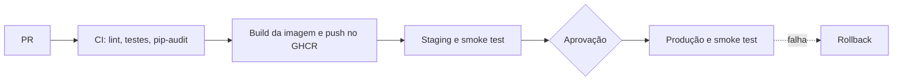

# Café com Deploy

API de cafés especiais com pipeline de CI/CD (GitHub Actions, Docker, GHCR e Render).

- Staging: https://cafe-staging-arthur.onrender.com
- Produção: https://cafe-prod-arthur.onrender.com

Para rodar local: `cp .env.example .env` e `docker compose up --build`. A documentação da API fica em http://localhost:8000/docs.

## Relatório de Voo

### 1. Pipeline

Todo merge na `main` dispara o workflow `cd`: o CI roda de novo, a imagem é construída uma vez e publicada no GHCR com o SHA do commit como tag, vai para o staging, passa por um smoke test em `/version`, espera a minha aprovação e só então é promovida para produção, usando a mesma imagem.

### 2. Diagnóstico

| Antes (Café com Deploy) | Agora | Por que importa |
|---|---|---|
| Deploy por FTP, na mão | Pipeline disparado pelo merge na main (`cd.yml`) | Deploy manual depende de lembrar os passos e não deixa registro do que foi publicado. |
| Testar só no final | Staging recebe a mesma imagem que vai para produção | O que foi validado é exatamente o que sobe, sem diferença entre ambientes. |
| Configuração feita à mão | Variáveis de ambiente e GitHub Environments | A configuração fica fora do código e separada por ambiente, como pede o Twelve-Factor. |
| "Funciona na minha máquina" | Docker multi-stage | O ambiente de execução viaja junto com a aplicação. |
| `ALTER TABLE` manual em produção | Migrations com Alembic, aplicadas na subida do container | A mudança no banco fica versionada e acontece sempre do mesmo jeito. |
| Senha no código | Secrets do GitHub e `.env` fora do Git | Nenhum segredo vai para o repositório. |
| Dependências soltas | Versões fixadas, Dependabot e `pip-audit` | Sei exatamente o que roda em produção e recebo aviso de vulnerabilidades. |
| Sem registro da versão no ar | `/version` devolve o SHA do commit | Dá para responder qual versão está rodando e a partir de qual commit. |

### 3. Testes

- Unitários: 7 (regras de desconto, incluindo limites, valor negativo e o máximo configurável por variável de ambiente)
- Integração (API + banco): 11 (criar, listar e consultar cafés, campo `origem`, erros 404, 409 e 422, desconto pela API)
- Smoke tests: 2 (staging e produção, conferindo `/version` depois do deploy)
- Total: 18 testes
- Cobertura: 98% (97,73% na última medição local; o CI falha se ficar abaixo de 70%)

Os testes de integração rodam contra um SQLite descartável, nunca contra o banco de staging ou de produção.

O CI já barrou uma alteração minha: no PR #15 (`fix: ajusta limite de desconto`) o run #34 ficou vermelho em 22 s porque um teste falhou, e o run #35 ficou verde depois da correção, no mesmo PR.

### 4. Dados

- 0001: cria a tabela `cafes`
- 0002: insere o cardápio inicial (6 cafés)
- 0003: adiciona a coluna `origem`

Padrão expandir e contrair: a coluna `origem` foi adicionada como um campo a mais na tabela, sem remover nem alterar nada que já existia. Por isso a versão anterior da aplicação, que não conhece essa coluna, continua funcionando com o banco já migrado, e dá para fazer rollback da aplicação sem perder dados. A fase de contrair (remover ou trocar algo antigo) só aconteceria numa versão futura, depois que nenhuma versão em uso dependesse do formato antigo.

Observação: a migration 3 foi criada junto com a base do projeto e não depois do primeiro deploy em produção, como o enunciado sugere. As migrations rodam automaticamente quando o container sobe, e staging e produção usam bancos diferentes no Neon.

### 5. Incidente em produção e rollback

Depois do deploy do commit `95605bc`, a rota `/cafes` passou a responder erro 500 em produção. O log do Render mostrou um `ResponseValidationError`: a resposta exigia que `origem` fosse um texto, mas os 6 cafés que já estavam no banco tinham `origem` vazia (nula).

O que aprendi com isso:
- Os testes não pegaram o erro porque o banco de teste começa vazio, sem dados antigos.
- O smoke test só olhava `/version`, então o pipeline considerou o deploy saudável mesmo com `/cafes` quebrado.
- Corrigi tornando `origem` opcional na resposta (PR `fix/origem-opcional`), o que gerou o commit `7a35cce`, que é a versão em produção hoje.

Recuperação: o erro apareceu nos logs do Render às 21:05 e a correção (PR #14) estava em produção por volta das 21:39, ou seja, uns 34 minutos de `/cafes` fora do ar, corrigindo para frente.

Depois do incidente, testei o workflow `rollback` de verdade: voltei a produção para a versão `7a35cce` (48 s até a versão estar no ar, confirmada em `/version`) e depois para a `3ae5e37` (também 48 s). Em um incidente real, o rollback teria me devolvido o serviço bem mais rápido do que esperar uma correção passar pelo pipeline inteiro.

### 6. Métricas DORA

| Métrica | Valor | Como calculei |
|---|---|---|
| Frequência de deploy | 5 deploys em produção em 17/10/2026 | execuções do `cd` com o job `production` verde (#4 a #8) |
| Lead time | cerca de 3 min 30 s | média da duração das 5 execuções do `cd` que chegaram à produção (1m39, 3m07, 6m03, 3m38 e 3m04), do merge até o fim do deploy, incluindo a espera pela minha aprovação |
| Taxa de falha | 20% (1 de 5) | 1 deploy precisou de correção: o do commit `95605bc`, que quebrou `/cafes` |
| Tempo de recuperação | 48 s (rollback) e cerca de 34 min (correção para frente) | 48 s é o tempo impresso pelo workflow `rollback`; 34 min é do erro nos logs (21:05) até a correção em produção (21:39) |

As 3 execuções vermelhas do `cd` (#1, #2 e #3, de 15 e 16/10) aconteceram antes do primeiro deploy em produção, então não entram na taxa de falha. Elas mostram o pipeline parando no meio, por exemplo quando o `pip-audit` detectou uma vulnerabilidade no starlette.

### 7. Implantação contínua?

Na minha opinião, hoje a Café com Deploy ainda não deveria ter implantação contínua. Eu manteria a aprovação manual.

O motivo é o que aconteceu comigo: um erro passou pelos testes e foi para produção, e a rota `/cafes` ficou fora do ar. Meus testes não pegaram porque o banco de teste começa vazio, e o smoke test só olhava `/version`. Numa loja real, isso deixaria o cardápio e os preços dos totens com problema. A aprovação manual me dá um momento para parar e olhar antes de subir. Desta vez eu não percebi o problema, mas sem ela o erro teria ido direto para produção, sem eu nem ver.

Também vi que o rollback é rápido (48 segundos), o que reduz o estrago. Mesmo assim, ele só ajuda depois que o problema já apareceu.

Para um dia abrir mão da aprovação, eu primeiro faria o smoke test chamar `/cafes`, testaria a API com dados antigos no banco e liberaria mudanças aos poucos (feature flags). Aí sim eu me sentiria seguro.

Sobre como aprendi: eu já tinha um conhecimento básico de Git e GitHub, mas pesquisando durante o projeto consegui ter uma visão bem melhor de como tudo se encaixa e ainda peguei uns "bizus" no caminho. Nos erros que apareceram (o 400 do staging, o Dependabot no branch errado, o lint e o erro 500), eu estudei com IA e com vídeos do YouTube para entender o que estava acontecendo, e não só copiar a solução. Foi assim que entendi, por exemplo, por que o teste passava e a produção quebrava.

### 8. Integrantes

| Nome | Matrícula | GitHub | Papel |
|---|---|---|---|
| Arthur Almeida Soares | 82602179 | ArthurAlmeidas | Todos os papéis (trabalho individual) |

### Conquistas desbloqueadas

Nenhuma das conquistas opcionais foi desbloqueada.
